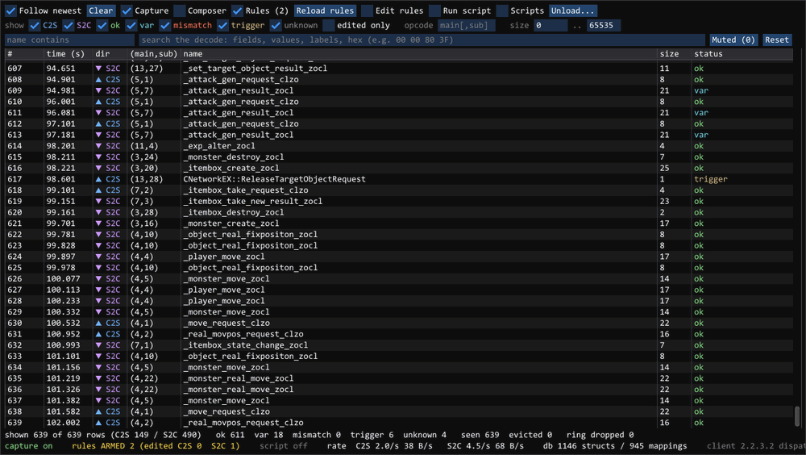
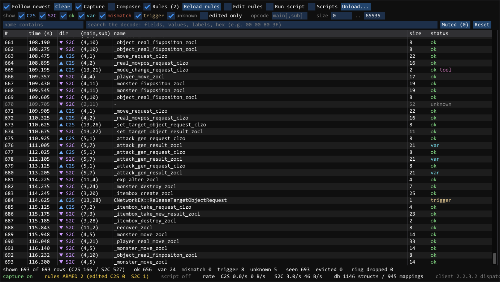
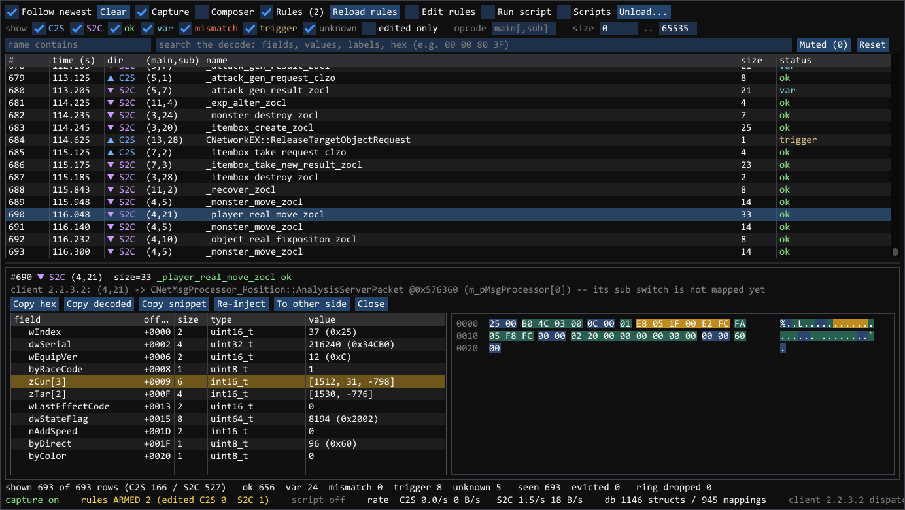
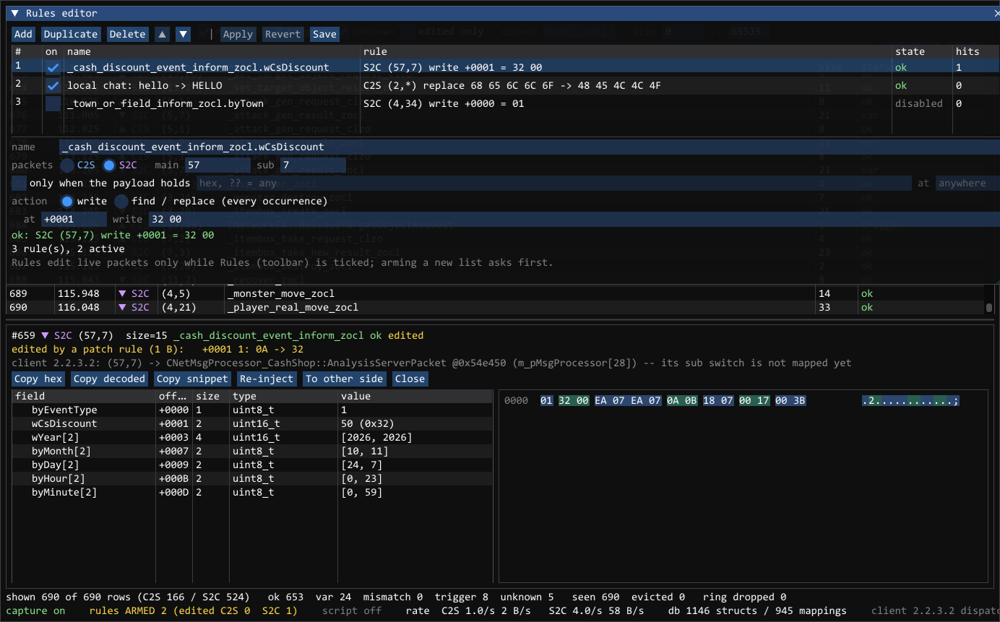
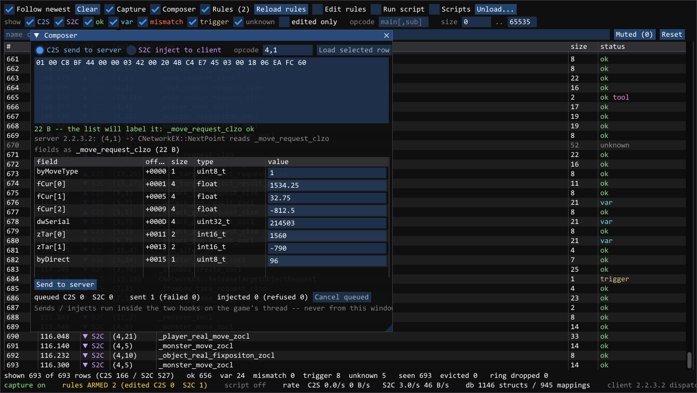
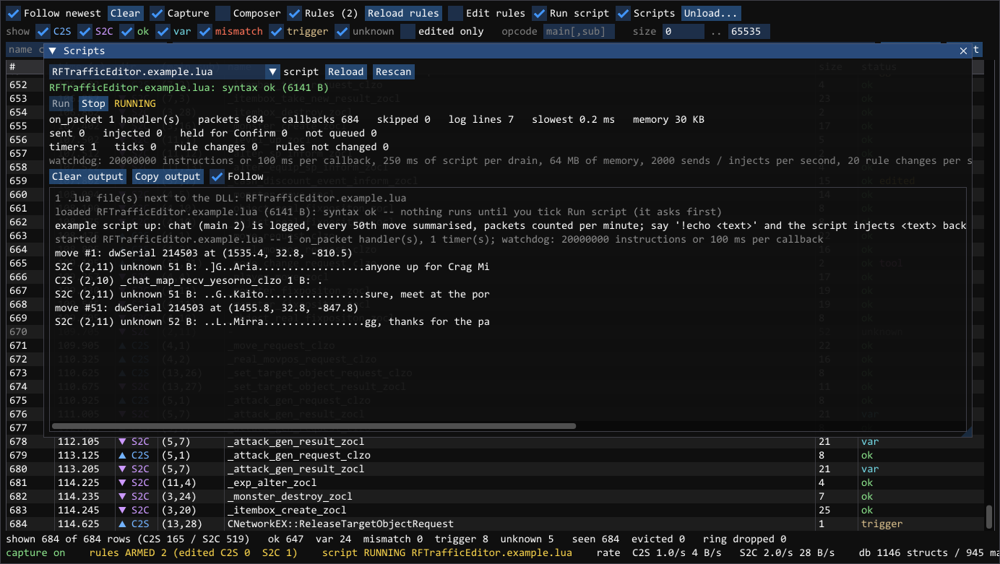

# RF Pktnik

A tool for watching and changing the network traffic of the **RF Online** game client.

It is a DLL (`RFTrafficEditor.dll`) that you load into the running game. It opens its own window
and shows every packet the game sends and receives, with each field decoded. You can also send your
own packets, change packets on the fly, and automate all of this with Lua scripts.

It is made for studying the game protocol and for testing your own server.



> Not affiliated with the game's developers or publishers. Using it on servers you don't run may
> break their rules — that is up to you.

## Features

- **Live packet list** — every packet in both directions, with its opcode, name and size.
- **Decoding** — click a packet to see every field and its value, next to the raw bytes.
- **Filters** — by direction, opcode, name, size or any text in the decoded packet.
- **Copy** — as hex, as decoded text, or as C code.
- **Send packets** — build a packet by hand (or edit a captured one) and send it to the server,
  or feed it to the game as if the server had sent it.
- **Patch rules** — change bytes in matching packets automatically as they pass through.
- **Lua scripts** — react to packets and send your own, from a script.
- **Log** — everything is also written to `RFTrafficEditor.log` next to the DLL.

Works with the **2.2.3.2**, **4.15**, **4.55** and **EP1P2** clients. Packet decoding is based on
**2.2.3.2**; other versions are captured fully, but some packets may not decode.

## Screenshots

The screenshots show a demo session.

**Packet list** — every packet with its direction, opcode, struct name, size and status. `var`,
`trigger` and `unknown` tell you how well a packet matched its struct; `edited` and `tool` mark
packets changed by a rule or sent by you.



**Packet viewer** — every field of the packet with its offset, type and value. Click a field to
highlight its bytes in the hex view.



**Patch rules** — a rule picks packets by direction and opcode and changes bytes at a field's
offset. Here a rule changed `wCsDiscount` in `_cash_discount_event_inform_zocl` from 10 to 50; the
viewer shows the edit.



**Composer** — build a packet field by field. The tool shows which struct it matches and which
server handler will read it.



**Lua scripts** — the example script running: it reads fields of move packets and logs chat.



## Building

You need Windows, Visual Studio 2022 (C++), CMake and [vcpkg](https://github.com/microsoft/vcpkg).
Set the `VCPKG_ROOT` environment variable to your vcpkg folder, then run:

```bash
cmake --preset x86
cmake --build build --config Release
```

The result is in `build/Release/`: `RFTrafficEditor.dll`, `packet_db.json` and two examples.
Keep `packet_db.json` next to the DLL. To run the tests: `ctest --test-dir build -C Release`.

## Using it

1. Start the game in **windowed** mode.
2. Inject `RFTrafficEditor.dll` with a normal (LoadLibrary) injector, for example Xenos in
   "Native" mode. Don't use manual mapping.
3. The tool's window opens. You can move it anywhere, even to another monitor.
4. To unload, press **Ctrl+Shift+End** or click **Unload…**. The game keeps running.

To send a packet: tick **Composer**, choose the direction, type the opcode (like `4,1`) and the
bytes in hex — or fill in the fields — and press **Send to server** (or **Inject to client**). You
can also right-click any packet in the list to send it again.

## Scripts

1. Put a `.lua` file next to the DLL.
2. Click **Scripts** in the toolbar, pick your file and press **Run**.

A small example — log every chat packet you send:

```lua
on_packet(function(p)
  if p.dir == "C2S" and p.main == 2 then
    log("chat:", p:hex())
  end
end)
```

What a script can use:

| | |
|---|---|
| `on_packet(function(p) ... end)` | called for every packet |
| `p.dir`, `p.main`, `p.sub`, `p.size`, `p.name`, `p.bytes` | the packet (`p.dir` is `"C2S"` or `"S2C"`) |
| `p:field("name")` | a field's value, by name |
| `p:u8(offset)`, `p:u16`, `p:u32`, `p:f32`, `p:hex()` | read raw bytes |
| `send_to_server(main, sub, bytes)` | send a packet to the server |
| `inject_to_client(main, sub, bytes)` | give a packet to the game |
| `make("struct_name", {field = value})` | build packet bytes by field names |
| `log(...)` | print a line in the Scripts window |
| `on_tick(ms, fn)`, `after(ms, fn)` | repeat or delay something |
| `rules.add{...}`, `rules.enable(name, on)` | change the patch rules |

The first packet a script sends asks you to confirm. Scripts have no file or system access, and a
script that runs too long is stopped. See `RFTrafficEditor.example.lua` for a fuller example.

## Changing packet structures

All packet layouts are in **`data/packet_db.json`**. It describes the **2.2.3.2** protocol. If a
packet is different in your client or server, or one is missing, edit this file.

It has two parts:

- **`structs`** — the layout of each packet: its size and its fields.
- **`opcodes`** — which packet number `(main, sub)` uses which struct.

A struct:

```json
"_move_request_clzo": {
  "size": 22,
  "fields": [
    { "name": "byMoveType", "type": "uint8_t",  "offset": 0,  "size": 1 },
    { "name": "fCur",       "type": "float",    "offset": 1,  "size": 12, "count": 3 },
    { "name": "dwSerial",   "type": "uint32_t", "offset": 13, "size": 4 },
    { "name": "zTar",       "type": "int16_t",  "offset": 17, "size": 4,  "count": 2 },
    { "name": "byDirect",   "type": "uint8_t",  "offset": 21, "size": 1 }
  ]
}
```

- `offset` and `size` are in bytes. There is no padding: fields sit exactly where `offset` says.
- `count` is for arrays (`fCur` above holds 3 floats).
- Types: `uint8_t`, `int8_t`, `uint16_t`, `int16_t`, `uint32_t`, `int32_t`, `uint64_t`,
  `int64_t`, `float`, `double`, `bool`, `char` (a `char` array is shown as text).
- A field can be another struct: add `"struct": "<its name>"`.
- Add `"var": true` if the packet ends with a buffer of varying length, so shorter packets are not
  marked as wrong.

An opcode entry:

```json
{ "main": 4, "sub": 1, "dir": "clzo", "struct": "_move_request_clzo" }
```

`dir` is `"clzo"` for client → server and `"zocl"` for server → client. If several structs are
listed for the same opcode, the one whose size matches the packet is used; you can also pick one
by hand in the packet's details.

After editing, rebuild (the build copies the file next to the DLL) or edit the copy next to the DLL
directly. The file is read once, so unload the tool and inject it again. Scripts use the same file
for `p:field` and `make`.

## License

[MIT](LICENSE)
